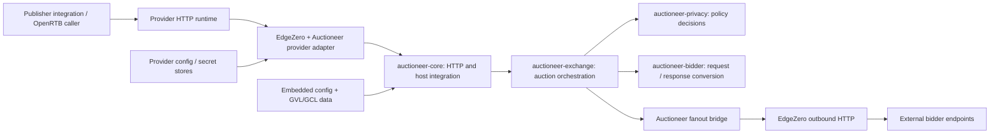

# Auctioneer Architecture

Updated: 2026-10-14

Auctioneer is an OpenRTB 2.6 header-bidding server written in Rust. It receives
an auction request, resolves publisher policy, prepares a private request
for each eligible bidder, sends bounded outbound HTTP calls, and returns
bids with auction targeting, warnings, and timing information.

One auction implementation serves four deployment targets: native Axum,
Cloudflare Workers, Fastly Compute, and Spin. EdgeZero supplies the host
integration; Auctioneer supplies the bidding application and its policies.

This document is the architectural map, not a replacement for the detailed
behavioral specifications or evidence that a deployment is production-ready.

Selected bidder implementations, metadata and reference behavior draw on
[Prebid Server](https://github.com/prebid/prebid-server), by Prebid.org and its
contributors. Auctioneer's modified Rust implementations and policy differences are
documented separately; see the [acknowledgements](../README.md#acknowledgements)
and [NOTICE](../NOTICE) for attribution.

## Contents

- [Scope and source of truth](#1-scope-and-source-of-truth)
- [System context](#2-system-context)
- [Components and crates](#3-components-and-crates)
- [Auction request lifecycle](#4-auction-request-lifecycle)
- [Privacy architecture](#5-privacy-architecture)
- [Configuration and reference data](#6-configuration-and-reference-data)
- [EdgeZero boundary and deployment](#7-edgezero-boundary-and-deployment)
- [Resource and state lifetimes](#8-resource-and-state-lifetimes)
- [Security and failure boundaries](#9-security-and-failure-boundaries)
- [Routes and operations](#10-routes-and-operations)
- [Verification and extension guide](#11-verification-and-extension-guide)

## 1. Scope and Source of Truth

This map describes the merged M5 source inherited by `m6-hardening` from
`main` at `b01c309`. Its M4 base had locally
verified parsing, policy decisions, bounded outbound construction, and
measured per-auction reservations; see the
[M4 verification record](superpowers/plans/2026-09-28-m4-verification.md).
M5 sync routes and supporting modules passed native integration, host
conformance, and three target compilation checks; see the
[M5 verification record](superpowers/plans/2026-09-30-m5-verification.md).
The M5 record separately identifies local same-site browser checks and
remaining cross-site and hosted-provider evidence. None of these inherited
checks establishes completion of M6.

| Concern                                                                 | Authoritative location                                                                                                                                           |
| ----------------------------------------------------------------------- | ---------------------------------------------------------------------------------------------------------------------------------------------------------------- |
| Current modules and dependencies                                        | [Workspace manifest](../Cargo.toml), crate manifests, and source                                                                                                 |
| Product direction and standalone/embedded delivery goals                | [Product vision](../vision.md)                                                                                                                                   |
| HTTP routes and provider configuration                                  | [EdgeZero manifest](../edgezero.toml)                                                                                                                            |
| Detailed auction/privacy behavior and intentional reference differences | [Master design](superpowers/specs/2026-05-21-auctioneer-openrtb-server-design.md)                                                                                    |
| M3b transport, admission, and resource requirements                     | [M3b plan](superpowers/plans/2026-07-10-m3b-multi-adapter-production-fanout.md)                                                                                  |
| M4 auction-privacy requirements                                         | [M4 design](superpowers/specs/2026-09-26-m4-privacy-design.md)                                                                                                   |
| Classified disclosure boundary and current local evidence               | [Scrub design](superpowers/specs/2026-10-09-gdpr-scrub-classification-design.md) and [execution ledger](superpowers/sdd/2026-10-11-gdpr-scrub-classification.md) |
| M5 sync contract and intentional differences                            | [M5 design](superpowers/specs/2026-09-30-m5-usersync-design.md)                                                                                                  |
| Future milestone priority and deferred scope ownership                  | [Approved roadmap](roadmap.md)                                                                                                                                   |
| Deployment mode and provider capability policy                          | [EdgeZero manifest](../edgezero.toml) and [deployment guidance](deployment/restrict-operational-endpoints.md)                                                    |
| Committed execution ledgers                                             | [`docs/superpowers/sdd/`](superpowers/sdd/) alongside specs and plans                                                                                            |

The master design contains historical review notes and older dependency
pins. For what this checkout actually builds, consult `Cargo.toml` and
`Cargo.lock`: its EdgeZero revision is
`f6c708ccb5be19ba9fa92575db3c08c0f17e0d72`, using Rust 1.98.1. Source code describes current
behavior; the milestone documents describe required and proposed behavior.
Do not silently treat a difference between them as implemented work.

### Capability Snapshot

| Area                                                               | State in this snapshot                                                                                                                                                                  |
| ------------------------------------------------------------------ | --------------------------------------------------------------------------------------------------------------------------------------------------------------------------------------- |
| OpenRTB preparation, bidder splitting, targeting, auction response | Implemented, M1/M2 foundations                                                                                                                                                          |
| GDPR/TCF decisions, versioned GVL/GCL validation, GDPR scrubs      | Implemented, M3a                                                                                                                                                                        |
| Multi-provider fanout and strict runtime-config resolution         | Implemented M3b paths; production qualification remains separate                                                                                                                        |
| Whole-runtime admission, memory accounting, and egress ownership   | Admission lifetime, measured phase reservations, bounded construction, and response ownership are integrated; over-ceiling boot still warns rather than proving a physical memory bound |
| GPP decoding, CCPA, activity controls, complete LMT/COPPA scrubs   | Implemented and locally verified M4 policy components, auction wiring, and resource accounting                                                                                          |
| User-sync endpoints and cookie lifecycle                           | M5 signed handlers and local Chromium same-site checks passed; cross-site browser and hosted-provider verification remain separate                                                      |
| Debug response surface and remaining parity hardening              | [M6 hardening design](superpowers/specs/2026-10-05-m6-parity-hardening-design.md); auction `ext.debug` remains suppressed until its bounded capture/redaction contract is implemented   |
| Deployment qualification                                           | Manifest is development/staging; production capability policy and hosted evidence remain separate                                                                                       |

M1-M6 are milestones within the initial core-auction/privacy scope, not
the entirety of the longer-term OpenRTB product. The
[approved roadmap](roadmap.md#2-milestone-ownership) assigns the deferred
work to M7-M20 without changing this snapshot's implemented capabilities;
the [2026-10-26 scope correction](roadmap.md#2026-10-26-scope-correction)
separates M7 foundation/priority acceptance from M20 full-catalog closure.
The [2026-10-27 sequencing correction](roadmap.md#2026-10-27-post-pilot-bidder-expansion)
places additional bidder waves under M7.7 after selected Trusted Server/publisher
testing, before the parity program. Neither correction changes implemented capabilities.

### Planned Extension Order

The next priority is M7's foundations and full selected-flow acceptance for
all 14 priority bidders, including Sharethrough, Rubicon and APS, with
automatic build-time registration and parameter/schema/resource qualification
requirements intact. After M7.5 embedding and selected M7.6 testing, M7.7 expands
the bidder set through reviewed demand-led waves before M8 onward. Residual
full-catalog migration/closure belongs to M20 and does not gate M7 or the
finite M7.7 queue. Current schema/resource/promotion safeguards remain mandatory.
Operators will continue to enable/disable already compiled, baked-eligible
bidders through runtime config without rebuilding; new bidder code or baked metadata still requires
a rebuild. Generated registration is planned, not the current implementation.

M8-M11 then prioritize stored requests/accounts, shared currency/multibid/UID
projection, creative caching, and full video delivery including the video
endpoint and ad-pod workflows. M12-M19 own the remaining FPD, floors and
adjustments, AMP/native, privacy/transparency, compressed ingress,
hooks/modules, metrics/analytics, and browser compatibility work. See the
roadmap for dependencies and completion criteria; this overview does not
claim those future interfaces or endpoints exist today.

The [product vision](../vision.md#two-delivery-modes) makes direct in-binary
integration with IAB Tech Lab Trusted Server a first-class goal alongside
the standalone HTTP service. `auctioneer-exchange::run_auction` is an existing
reusable engine boundary; the Trusted Server host bridge and its integration
evidence are explicitly owned by
[M7.5](roadmap.md#7-trusted-server-embedding-milestone), before the video/parity
program and without requiring full catalog closure. Embedding must preserve
normalization, privacy, deadlines, and resource accounting rather than
create a second auction implementation.

## 2. System Context



The diagram shows request/control flow, not every Cargo dependency. Bids
return through the fanout bridge, exchange, core handler, and provider
response path. The caller supplies privacy signals, often collected by a
CMP; Auctioneer still has to interpret those signals and enforce the resulting
per-bidder data restrictions before sending anything externally.

There is no Auctioneer database dependency on the current auction path. Runtime
configuration comes through EdgeZero stores, while bidder metadata and
privacy reference data are embedded in the artifact. This is a request
processor, not a durable auction-history or user-profile service.

## 3. Components and Crates

The workspace currently contains 15 packages: six portable libraries,
`auctioneer-core`, four hosting adapters, two shared schema libraries, one operator
CLI and one build-time catalogue library. Integration tests belong to their
owning packages. These are build and dependency boundaries within one system,
not 15 independently deployed services.

### Portable Libraries

| Crate                                                     | Responsibility                                                                                                     | Important boundary                                                                                             |
| --------------------------------------------------------- | ------------------------------------------------------------------------------------------------------------------ | -------------------------------------------------------------------------------------------------------------- |
| [`auctioneer-openrtb`](../crates/auctioneer-openrtb/src/lib.rs)   | Typed requests, responses, extensions, validation, implicit field preparation                                      | `prepare()` produces the externally nonconstructible `NormalizedBidRequest`; it does not parse consent strings |
| [`auctioneer-config`](../crates/auctioneer-config/src/lib.rs)     | Effective host/account/bidder types, embedded defaults, generated accessors, reference-data archive                | Build-time file reading/code generation; no request-time filesystem access                                     |
| [`auctioneer-runtime`](../crates/auctioneer-runtime/src/lib.rs)   | Clock/RNG/timer abstractions, portable limits, budgets, admission and egress accounting                            | Models resource policy without importing provider SDKs                                                         |
| [`auctioneer-privacy`](../crates/auctioneer-privacy/src/lib.rs)   | Signal resolution, TCF parsing, GVL/GCL lookup, legal-basis and bidder permissions                                 | Determines policy; does not send HTTP or own the bidder registry                                               |
| [`auctioneer-bidder`](../crates/auctioneer-bidder/src/lib.rs)     | Bidder trait, registry, endpoint/request helpers, protocol-specific bidder implementations                         | Synchronous conversion, no network I/O                                                                         |
| [`auctioneer-exchange`](../crates/auctioneer-exchange/src/lib.rs) | Aliases, request splitting, privacy enforcement, limits, fanout scheduling interface, targeting, response assembly | Reusable auction engine, no EdgeZero dependency                                                                |

These six libraries do not depend on EdgeZero, Tokio, reqwest, or provider
SDKs. Production host interactions enter through injected interfaces such
as `Clock`, `Rng`, `Timer`, and `BidderFanout`. The
[dependency-purity test](../crates/auctioneer-core/tests/dependency_purity.rs)
guards the separation.

### Integration and Supporting Packages

| Package                                                             | Responsibility                                                                                                                                                                        |
| ------------------------------------------------------------------- | ------------------------------------------------------------------------------------------------------------------------------------------------------------------------------------- |
| [`auctioneer-core`](../crates/auctioneer-core/src/lib.rs)                   | EdgeZero app, HTTP handlers, config extraction/resolution, host-primitive registry, fanout bridge, response serialization                                                             |
| [`auctioneer-adapter-axum`](../crates/auctioneer-adapter-axum/)             | Native entry point, bootstrap, timing/runtime integration, and real-socket fanout integration tests                                                                                   |
| [`auctioneer-adapter-cloudflare`](../crates/auctioneer-adapter-cloudflare/) | Workers entry point and Workers-specific host primitives                                                                                                                              |
| [`auctioneer-adapter-fastly`](../crates/auctioneer-adapter-fastly/)         | Compute entry point and Fastly-specific host primitives                                                                                                                               |
| [`auctioneer-adapter-spin`](../crates/auctioneer-adapter-spin/)             | Spin component entry point and WASI-specific host primitives                                                                                                                          |
| [`auctioneer-config-schema`](../crates/auctioneer-config-schema/src/lib.rs) | Shared authoring/config-file shape used by build-time tooling and CLI; not a policy evaluator                                                                                         |
| [`auctioneer-gvl-schema`](../crates/auctioneer-gvl-schema/src/lib.rs)       | Shared GVL archive/index schema and validation for build/runtime/refresh tooling                                                                                                      |
| [`auctioneer-cli`](../crates/auctioneer-cli/src/main.rs)                    | Config validation/selection, EdgeZero operator tooling and qualification; bidder reference inspection, GVL refresh, reference-evidence checks and OpenRTB catalogue generation/checks |
| [`auctioneer-openrtb-catalogue`](../crates/auctioneer-openrtb-catalogue/)   | Pinned field-inventory extraction and build-time catalogue validation library; independent of the CLI and not an auction-time dependency                                              |

A **provider adapter** connects Auctioneer to a hosting runtime. A **bidder
implementation** translates an auction into a demand partner's protocol.
Adding a bidder does not require a new provider adapter or a new workspace crate.

### Why These Boundaries

Keep the portable engine and wire model separate from provider SDKs, and keep
provider adapters separate from each other. The bidder package is a synchronous
protocol implementation boundary; bidder implementations remain modules rather
than additional workspace packages. Runtime primitives are shared by those
libraries without importing the HTTP application layer.

The small schema packages are intentional: config code generation uses them as
build dependencies and the CLI shares their types. The CLI's default
`application` feature includes config, application and qualification commands.
With `--no-default-features`, bidder reference inspection, GVL refresh,
reference-evidence checking and OpenRTB catalogue commands remain available
without a dependency on `auctioneer-config` or the application. A stale or corrupt
embedded archive therefore cannot prevent building its repair command.
`auctioneer-openrtb-catalogue` remains a separate library used by config's build
script and the CLI; config builds do not depend on the operator executable.

The native transport fixtures live in the Axum adapter's `tests/` directory,
with fixture-only dependencies declared as dev-dependencies. CI explicitly runs
both transport binaries, so consolidation does not hide their coverage. The
fixtures test core fanout and the real EdgeZero client, not a full server boot
or behavior on other providers. See the [test scope](../crates/auctioneer-adapter-axum/tests/README.md).

### Dependency Direction

The main normal-dependency direction is:

```text
provider adapters -> auctioneer-core -> auctioneer-exchange
                               -> auctioneer-config / openrtb / privacy / bidder / runtime
                     auctioneer-exchange -> bidder / privacy / config / openrtb / runtime
                     auctioneer-bidder   -> config / openrtb
                     auctioneer-privacy  -> config / gvl-schema / openrtb / runtime
                     auctioneer-config   -> gvl-schema
```

Build dependencies add `auctioneer-config-schema`, `auctioneer-gvl-schema` and
`auctioneer-openrtb-catalogue` to config generation; the CLI reuses those libraries
in its corresponding command modes. Test-only dependencies are omitted above.
These libraries prevent tools and build scripts from importing the application
just to understand a file.

Crate boundaries follow ownership, portability, and build-time needs.
They are not intended to mirror every feature. M4 extends the existing
privacy, config, exchange, core, and runtime modules rather than creating
separate GPP, CCPA, or activity-control workspace crates.

## 4. Auction Request Lifecycle

The HTTP entry point is
[`handlers/auction.rs`](../crates/auctioneer-core/src/handlers/auction.rs).
The portable engine is
[`run_auction`](../crates/auctioneer-exchange/src/run/mod.rs), called with a
`NormalizedBidRequest`, an `AuctionContext`, and an immutable `AuctionPlan`.

```mermaid
sequenceDiagram
    participant C as Caller
    participant H as EdgeZero / provider adapter
    participant A as auctioneer-core
    participant E as auctioneer-exchange
    participant P as auctioneer-privacy
    participant B as Bidder implementations
    participant F as Fanout bridge / EdgeZero HTTP
    participant D as External bidders
    C->>H: POST /openrtb2/auction
    H->>H: Provider ingress handling
    Note over H,A: Auction admission covers work and serialization; separate egress permit covers response completion
    H->>A: Request context + clock + ingress lease
    A->>A: Resolve config/account, parse, prepare, aliases/plan
    A->>E: run_auction(normalized, context, plan, audit)
    E->>P: Resolve privacy once, then query bidder permissions
    P-->>E: Decisions + warnings
    E->>E: Privacy filter, sample, cap, projection preflight
    E->>E: Materialize survivors, then scrub
    E->>B: make_requests(sanitized request, bounded sink)
    B-->>E: Bounded accepted requests and build errors
    E->>F: send_all(calls, auction deadline)
    F->>D: Eligible requests, subject to provider concurrency
    D-->>F: Responses / transport failures
    F-->>E: Positionally correlated results
    E->>B: make_bids(sanitized bidder request, response)
    B-->>E: Typed bids / bidder errors
    E->>E: Validate bids, targeting, response assembly
    E-->>A: BidResponse
    A->>A: Serialization, deadline checks, egress gate when installed
    A-->>H: Response + egress lifetime/deadline metadata
    H-->>C: HTTP response
```

### Preparation and Identity

1. The provider hands the request to EdgeZero. `auctioneer-core::configure`
   registers the ingress admission policy for the host's pre-body hook.
   This does not imply a raw-parser guarantee: the handler's bounded read
   is not proof that earlier provider allocations were capped.
2. The handler uses the request's admission instant as the auction's
   monotonic start. Config/body-read time therefore consumes the budget.
3. Runtime config is resolved before body consumption. Account resolution
   precedes OpenRTB preparation so the specified error precedence is stable.
4. `prepare()` caps impressions, fills allowed implicit fields, validates
   structure, and rejects unsupported OpenRTB 2.5 privacy-field locations.
5. The handler validates fatal wire privacy signals, resolves aliases and
   disabled bidders, and freezes those decisions in an `AuctionPlan`.

Account identity selects publisher configuration; it is not by itself
authentication of the HTTP caller. Bidder identity also has two parts:
the requested/observable alias and its underlying core bidder. Keep both:
response seats, controls, and privacy vendor lookup have different uses.

### Bidder Isolation and Dispatch

The exchange resolves privacy before outbound work. The splitter selects
participating impressions, projects bidder parameters/FPD, and strips
competitor data. Privacy denial prevents bidder invocation; partial
permissions scrub only that bidder's owned request. One bidder's mutation
must not change the prepared request or a sibling bidder's data.

Sampling runs before the bidder-count cap so sampled-out bidders do not
consume active slots. Bidder implementations then produce zero or more HTTP
requests. The exchange validates endpoints and applies the outbound-request cap
before handing calls to the fanout implementation.

[`Bidder`](../crates/auctioneer-bidder/src/bidder.rs) separates `make_requests`
from `make_bids`; the network operation lives between them. The current
registry includes AppNexus, PubMatic, and a generic OpenRTB bidder
implementation.
Mocktioneer is enabled by the explicit `insecure-bidders` feature or by Axum's
test-only dependency when running its default socket tests. Normal production
builds do not enable it.
This is not a claim of compatibility with the entire upstream bidder catalog.

The current production factory selection still uses a central name match.
[Automatic bidder registration](superpowers/specs/2026-09-27-bidder-registry-design.md)
is an approved design direction, not implemented discovery. The
[M7 catalog specification](superpowers/specs/2026-10-16-m7-bidder-catalog-design.md)
refines it to adjacent `bidder.toml` declarations under
`auctioneer-bidder/src/bidders/<bidder_key>/mod.rs` and conventional `create_bidder()`
factories. Baked `implementation = "<bidder_key>"` bindings remain distinct from
exact public names; all bidder implementations stay in the existing crate and
public concrete types use `FooBidder`. Discovery will run during the build;
runtime configuration enables or disables eligible compiled bidders.
New implementations still require rebuilding, with no runtime plugin loading.

### Response Assembly

Transport failures and bidder decoding errors are normally bidder-local:
an otherwise valid auction can still return successful sibling bids.
The exchange correlates responses to the original call slots, validates
returned bids, computes price buckets and targeting, and chooses winners
with deterministic tie behavior. Response seats and extension maps use
stable ordering; completion order must not change bidder attribution.

The handler serializes the response, checks write deadlines, and attaches
egress ownership when the relevant gates/resources are installed. Completing
`run_auction` or returning from the handler does not mean the provider has
finished writing the response. The complete bounded path is an M3b
integration requirement, not implied by this diagram.

## 5. Privacy Architecture

### Implemented GDPR Path

[`PrivacyContext`](../crates/auctioneer-privacy/src/auction_context.rs) is
resolved once per auction. It retains the authorization timestamp, usable
TCF state, selected GVL, effective account/host enforcement settings, and
bounded warning information. Per-bidder permission checks read that state;
they do not fetch vendor data or reparse consent for each bidder.

The decisions are distinct: may this bidder receive a bid request, may it
receive identifiers, and may it receive precise geo? The exchange owns
the corresponding request mutations in
[`scrub/mod.rs`](../crates/auctioneer-exchange/src/scrub/mod.rs). Permission calculation
without outbound-byte enforcement is not a complete privacy feature.

The GVL is a versioned vendor archive, not simply the latest vendor list.
TCF evaluation selects the declared revision; GCL data authenticates CMP
identity/freshness. Missing or unusable reference data follows the defined
conservative permission row rather than inventing a consent grant.
An unusable consent string does not necessarily mean dropping every bid:
the configured purpose rules still distinguish bidding from identifiers.

### M4 Policy Extension

The [M4 design](superpowers/specs/2026-09-26-m4-privacy-design.md) extends
the same architecture with independent GDPR, CCPA, activity, LMT, and COPPA
state. Disabling GDPR must not disable those other policies. Decisions
combine monotonically: a later policy or bidder implementation must not
restore removed identifiers, geo, FPD, or transaction IDs.

M4 introduces bounded GPP envelope/source selection, section-2 TCF and
section-6 USP handling, legacy projection, the activity evaluator, retained
TCF disclosed-vendor membership, and the remaining scrub matrix. Its
parser-limit rejection and Unicode activity matching have focused regression
coverage. The independently testable GPP envelope parser lives inside
`auctioneer-privacy::gpp`, with no Auctioneer policy dependencies, so it can later
move to its own crate. Source selection and authorization stay outside it.

The exchange caches complete decisions by requested bidder identity, keeping
aliases distinct from their bases. Fetch denials run before bidder FPD
projection; permitted requests are scrubbed after FPD and receive any required
legacy privacy-signal projection before bidder request construction. Both
`make_requests` and `make_bids` receive that same sanitized bidder-local
request. The decision cache is released before outbound construction.

The retained-JSON-node charge includes measured nested-container overhead,
with one margin applied to every shape. Six prepaid phase reservations cover
config, ingress, privacy, projection, outbound construction, and response work.
Checks include simultaneous representations and request-dependent amplification
before projection and targeting. This logical accounting does not intercept the
allocator or prove physical memory safety under the current over-ceiling rows.

M5 replaces the earlier permissive sync API stub with endpoint-specific
privacy decisions. `/cookie_sync` checks the host cookie and each selected
syncer; `/setuid` has a narrower callback permission path, and `/getuids`
reads the stored UID map without writing it. These paths reuse the TCF,
GPP, USP, GVL/GCL, and activity primitives but do not imply that stored
UIDs are projected into auction bidder requests.

## 6. Configuration and Reference Data

Configuration has two different lifecycles:

| Layer                       | Input and owner                                                                                        | Activation                                           |
| --------------------------- | ------------------------------------------------------------------------------------------------------ | ---------------------------------------------------- |
| Baked defaults and metadata | `auctioneer-config` build inputs; bidder info, host/account defaults, bootstrap settings, EEA/GVL/GCL data | Rebuild and deploy an artifact                       |
| Runtime overrides           | Auctioneer runtime DTOs delivered through EdgeZero's config/secret-store integration                       | Validated configuration used by application handlers |

```text
authoring config / reference-data files
  -> schema and semantic validation
  -> build generation -> embedded artifact defaults

operator runtime config
  -> auctioneer-cli validation / runtime-payload selection
  -> EdgeZero config push and hash-bearing envelope
  -> provider config store
  -> EdgeZero extraction / integrity checking
  -> Auctioneer validation and host/account/bidder resolution
  -> one effective configuration for this request
```

The authoring file is [`auctioneer.toml`](../auctioneer.toml). Its `[baked.*]`
sections are consumed by the build, while the CLI pushes only `[runtime]`
to the logical `auctioneer_runtime` store. Accounts are carried in that runtime
blob, not fetched from separate account records. Runtime-field environment
overrides are applied at push time to keys already present in the source;
they are not a live, per-instance policy override channel. Boot health
credentials are a separate provider-specific input.

These layers are not interchangeable. M3b requires runtime policy to stay
within the installed boot envelope; that envelope's installation is still
pending in the default entry points. Field-specific merge rules preserve
omitted versus explicit values; aliases, per-account
settings, bidder kill switches, sampling, and timeouts are resolved rather
than applied by mutating the shared bidder registry.

Invalid or unavailable runtime configuration is not permission to switch
off privacy. The M3b resolver distinguishes permitted missing configuration
from extraction, integrity, parsing, and validation failures and uses
explicit error responses. Missing config defaults only when the separately
baked `allow_missing_config` permits it; its checked-in value is false.
Invalid config is a 500; backend unavailability/extraction timeout is a 503
with `Retry-After: 5`. `/status` remains available to report degradation.
Do not add an ad hoc fallback or a second config cache in a handler.

Config integrity and policy validity are separate checks. The current
envelope carries a SHA-256 digest for integrity/drift detection, not a
cryptographic signature proving who wrote it. Store-write access is the
trust boundary. Auctioneer additionally validates the decoded policy; a matching
hash does not make an invalid policy acceptable. There is no separate
signature over the runtime process or every auction.

Reference-data refresh is an operator/build workflow through the
[`auctioneer-cli` maintenance command](../crates/auctioneer-cli/src/maintenance/gvl/mod.rs)
and the [refresh workflow](../.github/workflows/refresh-gvl.yml):

```sh
cargo run --locked -p auctioneer-cli --no-default-features -- gvl refresh
```

The workflow fetches locked dependencies before running this archive-independent
CLI mode. Auctions do not perform network fetches to repair a missing GVL
revision. Parsed archive state can be shared within a runtime; refreshing the
deployed reference data requires the corresponding artifact update.

## 7. EdgeZero Boundary and Deployment

### Ownership

| Auctioneer owns                                            | EdgeZero/provider integration owns                                        |
| ------------------------------------------------------ | ------------------------------------------------------------------------- |
| OpenRTB and bidder protocol semantics                  | Provider request/response adaptation                                      |
| Account selection, privacy, scrubs, aliases, targeting | Host HTTP client and platform networking                                  |
| Allowed endpoints and application resource policy      | Outbound execution, provider-specific timeout/cancellation mechanisms     |
| Auction/bidder budget composition and result mapping   | Host clock, request-start and response-completion integration             |
| Runtime policy validation and response error taxonomy  | Config-store extraction, envelope integrity checking, secret-store access |
| Admission/egress decisions and permit accounting       | Invoking those decisions at the correct host lifecycle boundaries         |

The application does not replace provider HTTP implementations. Likewise,
EdgeZero does not know what a bidder, consent purpose, or price bucket means.

[`BidderFanout`](../crates/auctioneer-exchange/src/fanout.rs) is the portable
boundary. [`EdgeZeroFanout`](../crates/auctioneer-core/src/host_primitives/fanout.rs)
and the [outbound bridge](../crates/auctioneer-core/src/outbound/mod.rs) translate
Auctioneer calls into EdgeZero operations. Results retain positional identity
even when calls finish out of order or time out.

Multiple calls may be outstanding together; fanout is not a sequence of
one-request-at-a-time auction operations. The exact dispatch, completion,
cancellation, and deadline guarantees still depend on provider capabilities.
Portable async futures are `?Send`; host-specific adapters handle their
runtime requirements without making the auction libraries Tokio-specific.

### Targets and Capabilities

| Provider           | Build target             | Entry point                                              |
| ------------------ | ------------------------ | -------------------------------------------------------- |
| Axum               | Native                   | [main.rs](../crates/auctioneer-adapter-axum/src/main.rs)     |
| Cloudflare Workers | `wasm32-unknown-unknown` | [lib.rs](../crates/auctioneer-adapter-cloudflare/src/lib.rs) |
| Fastly Compute     | `wasm32-wasip1`          | [main.rs](../crates/auctioneer-adapter-fastly/src/main.rs)   |
| Spin               | `wasm32-wasip2`          | [lib.rs](../crates/auctioneer-adapter-spin/src/lib.rs)       |

The manifest separates required capabilities from optional/degraded ones.
A shared Rust interface is not proof of identical runtime guarantees.
For example, response-egress capabilities are declared optional/best-effort
in this snapshot. Normalized-header checks also cannot reconstruct framing
information a provider's raw HTTP parser has already removed.

Provider limitations must be documented and tested at that boundary, not
hidden behind success at the portable unit-test layer. They do not prevent
independent auction-policy work such as M4. Production readiness is a
separate evidence and release decision using the existing EdgeZero deployment
tooling, not a compiled milestone label or an extra signing scheme.

## 8. Resource and State Lifetimes

### Integration Status

The distinction between available components and the active path matters:

- All four default entry points call
  [`bootstrap_adapter_with_envelope`](../crates/auctioneer-core/src/host_primitives/bootstrap.rs),
  validating the envelope and installing shared gates before host primitives.
  The current over-ceiling configurations warn and boot; these are not proof
  of a whole-runtime memory bound.
- [`configure_app`](../crates/auctioneer-core/src/configure.rs) installs the
  bounded error renderer, detached-egress decision factory, ingress admission
  policy, and the measured config extraction limits. The ingress lease is
  retained throughout the auction and serialization.
- With an installed envelope and HTTP client, the handler constructs the
  wave-scheduler `EdgeZeroFanout`; explicit in-process test injection takes
  precedence. Regular responses can run without egress gates;
  write-deadline metadata is attached even without an envelope, using the
  framework default. Detached head-error responses abort if no static gate
  is available.
- [`serialize_response`](../crates/auctioneer-core/src/serialize.rs) has no
  byte cap without an installed envelope. With one installed, it reserves
  the output buffer fallibly and writes through `CappedWriter`, refusing
  oversize without constructing a full oversized temporary. Response-tree
  storage and serializer scratch have separate measured response-phase charges.
- Account discovery and typed ingress parsing use the installed JSON-node
  limit. A bounded token pass counts opaque and skipped subtrees before
  Serde validates and materializes values; over-limit requests receive the
  canonical 400 before account-state checks.
- The handler prepays all six measured phase charges before config extraction
  and holds their receipts through serialization. Checked projection and
  response estimates reject excess copy amplification before construction.
  Reservation failure returns fixed `503 overloaded\n`, never a consent
  warning or fallback permission. Cancellation releases both receipts and
  auction admission.
- A shared call budget and bounded metadata/body sinks constrain bidder
  construction. Transport finalization owns compression and controlled headers;
  raw and encoded body ceilings are independent. An encoded-finalization
  rejection keeps its correlation position without being reported as
  dispatched. A raw sink rejection creates a pre-fanout error, not a slot.

The lifetime/budget model is integrated and has allocation and cancellation
regressions plus passing local feature/cross-target acceptance. It is not a
whole-isolate physical memory guarantee: current rows
still exceed their declared ceilings, and provider capabilities remain distinct.

### Time and Memory

There are separate budgets for ingress/config work, the auction, bidder
calls, and response writing. Auction time is anchored to request admission.
Bidder-visible `tmax` and the server's clamped execution deadline are not
the same value. Per-bidder timeouts compose with the remaining auction
budget; a bidder timeout alone does not prove the whole auction expired.

Byte caps alone are insufficient: parsing, request clones, bidder output,
compressed/uncompressed buffers, accumulated bidder results, and final
serialization can coexist. M3b models these costs in the boot envelope,
per-request budgets, and concurrency classes. Claims of a whole-runtime
memory bound require evidence for all live allocations, not just a bounded
`Content-Length` or final `Vec` size.

Admission limits cover the shared runtime instance. Egress permits belong
to the response-completion lifecycle, not just the handler's stack frame.
Refusals, auxiliary routes, and pre-handler errors need bounded response
paths too; overload must not create an unlimited error-response queue.
The detailed limits and outstanding integration requirements stay in the
M3b plan and source rather than being duplicated as constants here.

### State Ownership

| Lifetime                  | Examples                                                                                           | Constraint                                                                                        |
| ------------------------- | -------------------------------------------------------------------------------------------------- | ------------------------------------------------------------------------------------------------- |
| Artifact/build            | Generated defaults, bidder metadata, reference-data archive                                        | Shared immutable input; changes require a build                                                   |
| Process/isolate bootstrap | Host primitives; validated envelope and shared gates                                               | Must not reset on every app construction; shared gate ownership is installed by adapter bootstrap |
| Reusable runtime data     | Bidder registry, parsed GVL/GCL data, health counters                                              | No request-specific consent or user identity stored here                                          |
| Request                   | Effective config/account, normalized input, alias plan, privacy context, deadlines, result bundles | Consistent decisions for one auction                                                              |
| Bidder/call               | Scoped request, outgoing bytes, slot correlation, local errors/timing                              | No competitor data or sibling mutation                                                            |
| Response write            | Serialized response and attached egress ownership                                                  | Lifetime ends at host-reported completion/abort, subject to provider fidelity                     |

`configure_app` runs per EdgeZero app construction, which may be per request
on serverless targets. Process/isolate-global gates therefore belong in
adapter bootstrap, not that callback. Per-app configuration installs hooks
that refer to those shared resources. This state is local to a process or
isolate, not durable or a fleet-wide concurrency limit.

## 9. Security and Failure Boundaries

Treat caller JSON, bidder output, and external config-store data as bounded
inputs with different trust levels. A bidder endpoint is selected through
operator-controlled metadata, not accepted as an arbitrary caller URL.

Endpoint construction and
[validation](../crates/auctioneer-exchange/src/validate_endpoint.rs) constrain
scheme/authority and reject forbidden IP literals, localhost aliases, and
userinfo. DNS resolution and connection-time behavior remain host/network
concerns; string validation alone is not a DNS-rebinding guarantee.
Loopback HTTP is an explicit test-build exception, not a production default.

Privacy applies to outbound bytes and headers, not only an in-memory
decision. Bidder projections and future identity injection must precede
the applicable scrubs. No later bidder/transport step may restore raw
caller identifiers or bypass endpoint policy.

| Failure scope                                               | Result                                                                                                         |
| ----------------------------------------------------------- | -------------------------------------------------------------------------------------------------------------- |
| Invalid auction/account/alias input                         | Request-level error using the existing HTTP taxonomy                                                           |
| Disabled account or exhausted ingress admission capacity    | Refuse before auction dispatch; capacity enforcement requires installed gates                                  |
| Egress capacity or write budget exhausted                   | Refuse the response even if auction work has completed; do not start another auction                           |
| Invalid runtime configuration                               | Fail loudly; no fallback to permissive privacy settings                                                        |
| One bidder denied by privacy                                | No request construction/send for that bidder; permitted siblings can continue                                  |
| One bidder times out or returns invalid data                | Bidder-local error/non-bid result; preserve other completed results                                            |
| Broken fanout contract or application invariant             | Request-level internal failure, not fabricated bids/results                                                    |
| Malformed/unusable consent under the existing GDPR contract | Bounded warning and conservative permission decisions; not an unconditional HTTP error                         |
| M4 GPP parsing-limit violation                              | Terminal input error, distinct from within-limit format warnings; never falls back to less restrictive consent |

Avoid raw consent, user identifiers, URLs with sensitive parameters, or
bidder bodies in diagnostics. Fanout public errors use fixed categories;
the debug response surface remains off until its redaction contract ships.
The document describes technical enforcement, not legal certification.

## 10. Routes and Operations

| Route                      | Purpose                                                                      |
| -------------------------- | ---------------------------------------------------------------------------- |
| `POST /openrtb2/auction`   | Live auction entry point                                                     |
| `GET /status`              | Liveness and `x-auctioneer-config-status` config verdict                         |
| `GET /info/bidders`        | Registry/alias catalog with configured visibility controls                   |
| `GET /info/bidders/{name}` | Bidder metadata, including the supported aggregate form                      |
| `GET /_auctioneer/health/gvl`  | Operator reference-data health and unavailable-lookup/staleness observations |
| `POST /cookie_sync`        | Bounded candidate selection and bidder sync URLs                             |
| `OPTIONS /cookie_sync`     | Exact-origin credentialed CORS preflight for POST/Content-Type               |
| `GET /setuid`              | Bidder callback; bounded `uids` cookie transaction                           |
| `GET /getuids`             | Read-only UID map for clients                                                |

`/status` is not proof of bidder reachability, usable consent data, or
production certification. The internal health route is fail-closed without
an installed access policy. Tokenless opt-in requires an ingress path
restriction; see [internal-route deployment guidance](deployment/restrict-operational-endpoints.md).

The sync routes use the auxiliary admission class and a validated runtime
config snapshot. The configured public `user_sync.external_url` supplies
the callback origin and optional base path; request `Host` and forwarded
headers do not. `user_sync.allowed_origins` controls exact-origin
credentialed JavaScript access, not privacy permission. After config
resolution, application responses can carry those CORS headers; earlier
admission, config, framework, or transport failures have narrower header
guarantees. Auctioneer-owned sync responses use `Cache-Control: no-store`.
The fixed `uids` cookie is distinct from the configured host identity cookie.
Production UID reads authenticate a versioned HMAC envelope before payload
decoding; writes sign a request-local eviction transaction under a 4-KiB
complete-cookie ceiling. One bounded atomic keyring comes from the default
EdgeZero secret store per request, with rotation and no unsigned fallback.
Signing protects issued state, not ownership of callback UIDs, account
authorization, consent or replay. See [key provisioning](deployment/usersync-cookie-keys.md).
Its acceptance depends on browser policy and context, which a native response
test cannot prove. See [operator setup](../README.md#user-sync-operator-setup-m5).

M5 does not own bidder-catalog migration: the
[2026-10-26 scope correction](roadmap.md#2026-10-26-scope-correction)
assigns foundations and all 14 priority flows to M7, and remaining full-catalog
migration/closure initially to M20. The 2026-10-27 sequencing correction brings
post-pilot bidder expansion into M7.7; M20 retains residual migration and
terminal closure. Nor does M5 inject stored `buyeruid` values into
auction bidder requests (owned by M9).
Full analytics/metrics delivery is also not implied by the current health
counters, warnings,
and request logging; the full engine/integrations are owned by M18. Deployment
qualification follows the manifest capability policy and provider evidence.

## 11. Verification and Extension Guide

The architecture is tested at several boundaries:

| Boundary                                                            | Evidence location                                                                                                                                             |
| ------------------------------------------------------------------- | ------------------------------------------------------------------------------------------------------------------------------------------------------------- |
| OpenRTB preparation and wire representation                         | [OpenRTB tests](../crates/auctioneer-openrtb/tests/)                                                                                                              |
| Privacy parsing and permission rules                                | [Privacy tests](../crates/auctioneer-privacy/tests/) and module tests                                                                                             |
| Bidder isolation, scrubs, targeting, deterministic response         | [Exchange tests](../crates/auctioneer-exchange/tests/)                                                                                                            |
| Config failures, handler ordering, admission/egress, response shape | [Core tests](../crates/auctioneer-core/tests/)                                                                                                                    |
| Fanout positional/deadline/cancellation contracts                   | [Shared conformance suite](../crates/auctioneer-core/src/conformance/mod.rs), provider tests, [native transport tests](../crates/auctioneer-adapter-axum/tests/README.md) |
| Build portability and feature combinations                          | [CI test workflow](../.github/workflows/test.yml)                                                                                                             |

Host-side conformance tests, cross-target compilation, and deployed-provider
probes answer different questions. A WASM `cargo check` does not exercise
the provider's real network, timer, or response-write implementation.
Compatibility fixtures must record their reference revision and intentional
differences; do not assume the CI wire-fixture corpus and the privacy
behavioral reference are pinned to the same upstream commit.

Use the existing ownership boundaries when extending the system:

| Change                            | Primary locations                                                                           | Keep out of                                            |
| --------------------------------- | ------------------------------------------------------------------------------------------- | ------------------------------------------------------ |
| Add a bidder                      | Bidder implementation + config metadata + registry tests                                    | Provider networking implementations                    |
| Add a privacy policy              | Privacy decisions + config types + exchange scrubs + outbound-capture tests                 | EdgeZero and schema-only packages                      |
| Add an HTTP endpoint              | Manifest + core handler + route/admission/egress policy + tests                             | Portable engine unless new domain behavior is needed   |
| Add a provider                    | Provider adapter + host primitives + capability/conformance evidence                        | Duplicate auction/privacy implementations              |
| Add a runtime setting             | Shared authoring shape where relevant, runtime DTO, validation, resolution, CLI/build tests | Unchecked per-handler parsing or another signing layer |
| Change limits                     | Runtime envelope/accounting + affected consumers + boundary tests                           | Constants that bypass boot bounds                      |
| Refresh vendor/CMP reference data | Refresh tool + schema/build validation + artifact rollout                                   | Network fetches inside privacy evaluation              |

For exact behavior, continue from this map into the master design and the
owning milestone document. Update this overview when ownership, public
entry points, state lifetimes, or implemented capability status changes.
